# Observant Systems: Overnight Sensation

Tzu-Yao (Regina) Chang (tc845)

<!-- **NAMES OF COLLABORATORS HERE**

For lab this week, we focus on creating interactive systems that can detect and respond to events or stimuli in the environment of the Pi, like the Boat Detector we mentioned in lecture. 
Your **observant device** could, for example, count items, find objects, recognize an event or continuously monitor a room.

This lab will help you think through the design of observant systems, particularly corner cases that the algorithms need to be aware of.

**New this year: the AI runs on the Pi.** Your Pi 5 can run an object detector ([YOLO](https://docs.ultralytics.com/)) and a small language model ([Qwen](https://ollama.com/library/qwen3.5) through [Ollama](https://ollama.com)) completely offline. In Part 1 you get both running and connect them: YOLO *sees*, Qwen *reasons* about what was seen. These models are slow, but they have all night. In Part 2 you use them to design a **night-time interaction**: what you tell the device before bed, what it does while you sleep, and what it shows you when you wake up.

**Please indicate anyone you collaborated with on this Lab here.**
Be generous in acknowledging their contributions! And also recognizing any other influences (e.g. from YouTube, Github, Twitter) that informed your design.  -->

## Overview

**Part 1: the tools**

A) [Set up your Pi for on-device AI](#part-a)

B) [See: recognize people in real time with YOLO](#part-b)

C) [See more: hands and pose with MediaPipe](#part-c)

D) [Reason: run Qwen on the Pi with Ollama](#part-d)

E) [Connect: from YOLO readings to Qwen reasoning](#part-e)

**Part 2: Overnight Sensation**

F) [Read Part 2 and storyboard your night-time interaction](#part-f)

G) [Design the interaction before bed](#part-g)

H) [Incorporate the observant system during sleep](#part-h)

I) [Design the interaction when awake](#part-i)

The tools from earlier versions of this lab (MobileNet, Teachable Machine, Moondream, audio analysis, classic OpenCV) live in the [legacy folder](legacy/README.md). They are optional, but any of them can be the sensor in your Part 2 system.


## Prep for Part 1

<!-- Please check the instructions in [prep.md](prep.md) and complete them before lab. The installs in Part A take a while, so prep.md also tells you how to get a head start.

## The Report

This readme.md page in your own repository should be edited to include the work you have done. You can delete everything but the headers and the sections between the \*\*\***stars**\*\*\*. Write the answers to the questions under the starred sentences. Include any material that explains what you did in this lab hub folder, and link it in the readme. -->

---

# Part 1

## Part A. 
<!-- ### Set up your Pi for on-device AI

Create a virtual environment and install the requirements. They include `ultralytics` (YOLO), which pulls in torch, so this takes a while:

```
pi@raspberrypi:~$ cd Interactive-Lab-Hub/Lab\ 5
pi@raspberrypi:~/Interactive-Lab-Hub/Lab 5 $ python3 -m venv .venv
pi@raspberrypi:~/Interactive-Lab-Hub/Lab 5 $ source .venv/bin/activate
(.venv) pi@raspberrypi:~/Interactive-Lab-Hub/Lab 5 $ pip install -r requirements.txt
```

As in Lab 3, [`uv`](https://docs.astral.sh/uv/) is a much faster drop-in for `pip`: `pip install uv && uv pip install -r requirements.txt`.

### YOLO: download the nano model and export it for the Pi

We use the nano model of [YOLO26](https://docs.ultralytics.com/models/yolo26/), exported once to NCNN, the format that runs fastest on the Pi. This downloads the weights:

```
(.venv) pi@raspberrypi:~/Interactive-Lab-Hub/Lab 5 $ python -c "from ultralytics import YOLO; YOLO('yolo26n.pt').export(format='ncnn')"
(.venv) pi@raspberrypi:~/Interactive-Lab-Hub/Lab 5 $ yolo export model=yolo26n.pt format=ncnn
```
If every ultralytics message is followed by a `--- Logging error ---` traceback ending in `UnicodeEncodeError: 'latin-1' codec can't encode character`, fix your shell's locale once::

```
echo 'export LANG=C.UTF-8' >> ~/.bashrc
echo 'export LC_ALL=C.UTF-8' >> ~/.bashrc
echo 'export PYTHONIOENCODING=utf-8' >> ~/.bashrc
source ~/.bashrc
```

The second command converts the .pt model to a .ncnn model.

Test it on an image from the internet. `project="$PWD"` keeps the output in `predict` in the current lab folder; without it, ultralytics writes to a `runs/` folder at the top of your git repo, where you will not think to look.

```
(.venv) pi@raspberrypi:~/Interactive-Lab-Hub/Lab 5 $ yolo predict model=yolo26n_ncnn_model source=https://ultralytics.com/images/bus.jpg project="$PWD"
```

The result is in `predict/bus.jpg`: boxes around the people and the bus.

Now a photo of your own. Plug in the webcam and take one with `snap.py` (`--delay 3` gives you three seconds to get into the frame), or choose any picture you downloaded from the internet and put under this folder. Put your selected picture after the `source=` Then run the same command on it:

```
(.venv) pi@raspberrypi:~/Interactive-Lab-Hub/Lab 5 $ python snap.py --delay 3
(.venv) pi@raspberrypi:~/Interactive-Lab-Hub/Lab 5 $ yolo predict model=yolo26n_ncnn_model source=snap.jpg project=runs
```

Every run gets its own numbered folder, so this one is in `runs/predict2/snap.jpg`; the command prints where it saved. Keep `snap.jpg`, you will show it to Qwen in Part D.

### Ollama: install it and pull Qwen

[Ollama](https://ollama.com) runs language models locally. Nothing leaves the Pi: no API key, no internet after the download.

```
pi@raspberrypi:~ $ curl -fsSL https://ollama.com/install.sh | sh
pi@raspberrypi:~ $ ollama pull qwen3.5:0.8b
pi@raspberrypi:~ $ ollama pull qwen3:0.6b
pi@raspberrypi:~ $ ollama list
```

| model | download | what it does |
|---|---|---|
| `qwen3.5:0.8b` | ~1.3 GB | text **and images**; the one we use in this lab |
| `qwen3:0.6b` | ~0.5 GB | text only, smaller and faster (~16 tokens/s on a Pi 5) | -->

\*\*\***Include a screenshot of `ollama list` showing your models, and the `bus.jpg` result and your own photo with their boxes.**\*\*\*
### Models and Detection Results

**Ollama models installed**

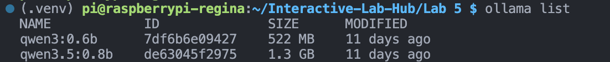

**YOLO detection on `bus.jpg`**


**YOLO detection on my own photo**

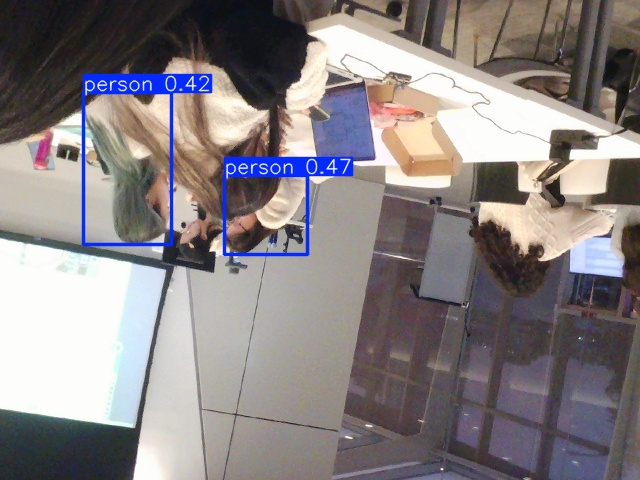

## Part B. 
<!-- ### See: recognize people in real time with YOLO

YOLO is an *object detector*: it finds every person, cup, cat and so on (the 80 [COCO](https://cocodataset.org/) classes), draws a box around each, and gives a confidence. For an observant system that is exactly what you want: *how many*, *where*, *how sure*.

Connect your webcam, connect to your Pi through **VNC** (the script opens a window), and run the person detector. Read `yolo_person.py` first; the loop at the bottom is the whole idea.

```
(.venv) pi@raspberrypi:~/Interactive-Lab-Hub/Lab 5 $ python yolo_person.py
```

While it runs, walk in and out of the frame, sit down, turn your back, hold up a photo of a person on your phone. Watch the confidence number on the box change with each.

Then press q to quit and run it again with a flag. Each one changes a single thing:

```
(.venv) pi@raspberrypi:~/Interactive-Lab-Hub/Lab 5 $ python yolo_person.py --conf 0.2     # lower the bar: see what the model is unsure about
(.venv) pi@raspberrypi:~/Interactive-Lab-Hub/Lab 5 $ python yolo_person.py --conf 0.7     # raise the bar: see what you lose
(.venv) pi@raspberrypi:~/Interactive-Lab-Hub/Lab 5 $ python yolo_person.py --all          # all 80 classes, not only people: what else is on your desk, and what does it get wrong?
(.venv) pi@raspberrypi:~/Interactive-Lab-Hub/Lab 5 $ python yolo_person.py --headless     # no window, only the printed readings: how it runs over ssh, and at night
``` -->

\*\*\***Include a short video or screenshots of the person detection. Write down three situations where it did not see you, or saw a person who was not there, and what you think the cause was.**\*\*\*
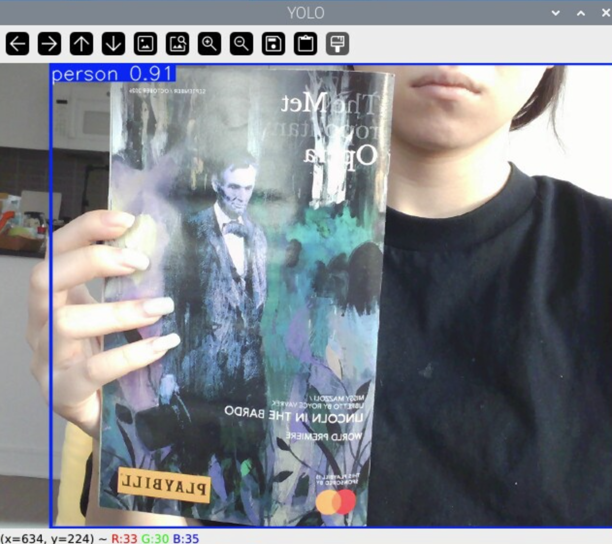

Failure Case 1 – Missed Person in a Printed Image**
YOLO successfully detected me with a confidence of 0.91, but it did not detect the person printed on the book cover. This may be because the printed person was relatively small, partially obscured, and visually different from a real person in the scene.

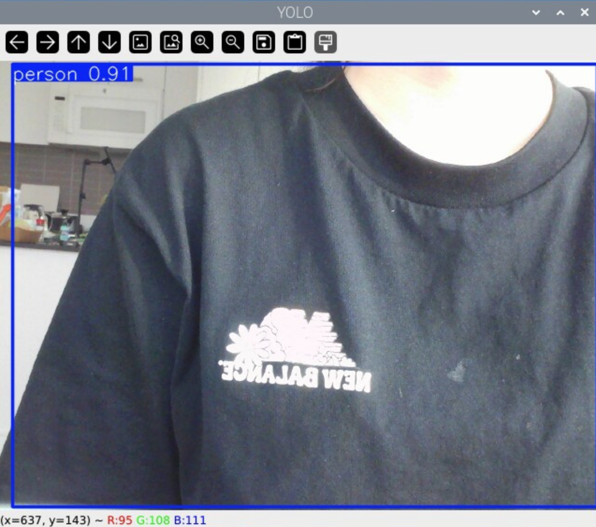

Failure Case 2 – Partial occlusion
When only part of my body was visible, YOLO sometimes failed to detect me or produced lower confidence because fewer human features were visible.


Failure Case 3 – Person in a printed image
YOLO detected people printed on a magazine/book cover as real people, with confidence scores around 0.74–0.81. This happened because YOLO detects visual patterns associated with the “person” class, but it does not understand whether the detected person is physically present or only appears in a photograph.


## Part C. 
<!-- ### See more: hands and pose with MediaPipe

YOLO tells you that a person is there. Google's [MediaPipe](https://mediapipe.dev/) tells you what their hands and body are doing: face, hand and body pose detection, fast on the Pi.


The demo plays a looping audio file, so make the helper script executable first:

```
(.venv) pi@raspberrypi:~/Interactive-Lab-Hub/Lab 5 $ chmod +x loop_audio.sh
```

Connect your webcam, connect to your Pi through **VNC**, and run the hand pose script:
(***it will not work if you use ssh from your laptop***)

```
(.venv) pi@raspberrypi:~/Interactive-Lab-Hub/Lab 5 $ python hand_pose.py
```

Try the two main features of this script: 1) pinching for percentage control (the thumb-to-index distance sets the volume), and 2) "[Quiet Coyote](https://www.youtube.com/watch?v=qsKlNVpY7zg)" for instant percentage setting (the gesture mutes it). Notice how this example uses hardcoded positions and relates those positions with a desired set of events, in `hand_pose.py`: a hand is 21 landmark coordinates, and an *event* is a rule you write over them. That is the same job as `interpret()` in Part E.

Consider how you might use this position based approach to create an interaction, and write how you might use it on either face, hand or body pose tracking. -->

\*\*\***Include a screenshot or short video of the hand pose demo, and write how you might use face, hand or body pose tracking in your observant system.**\*\*\*
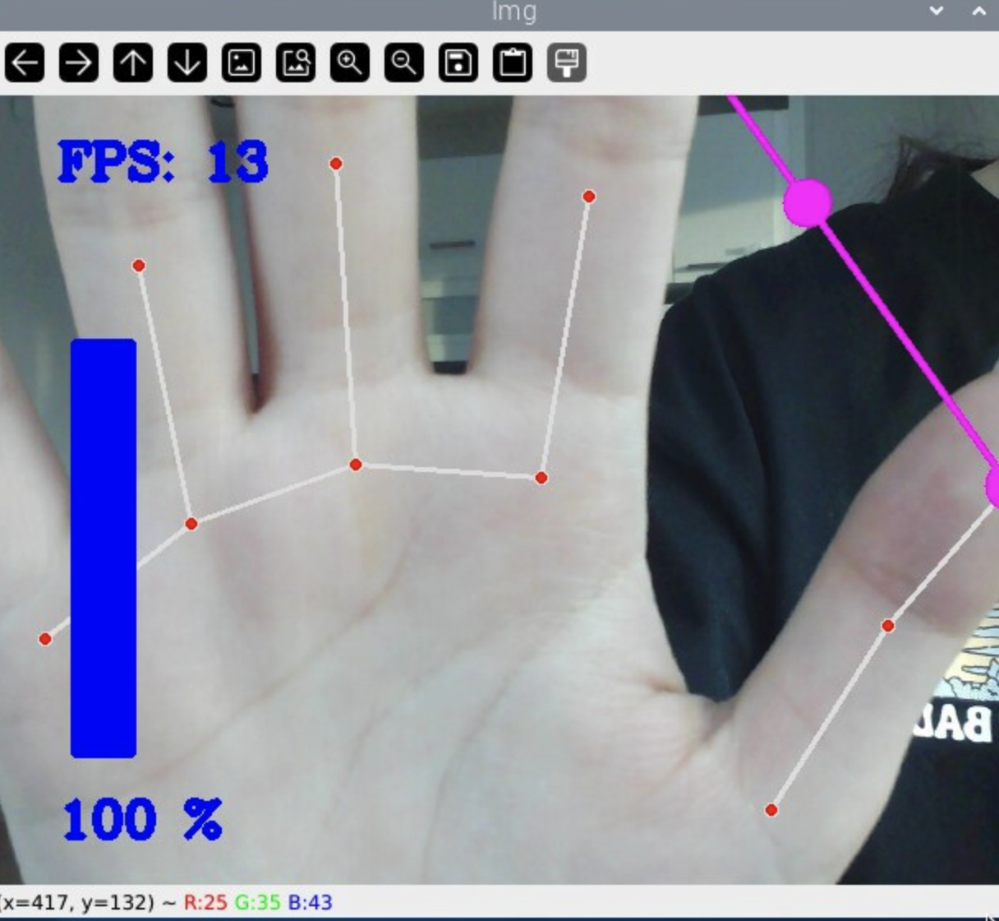
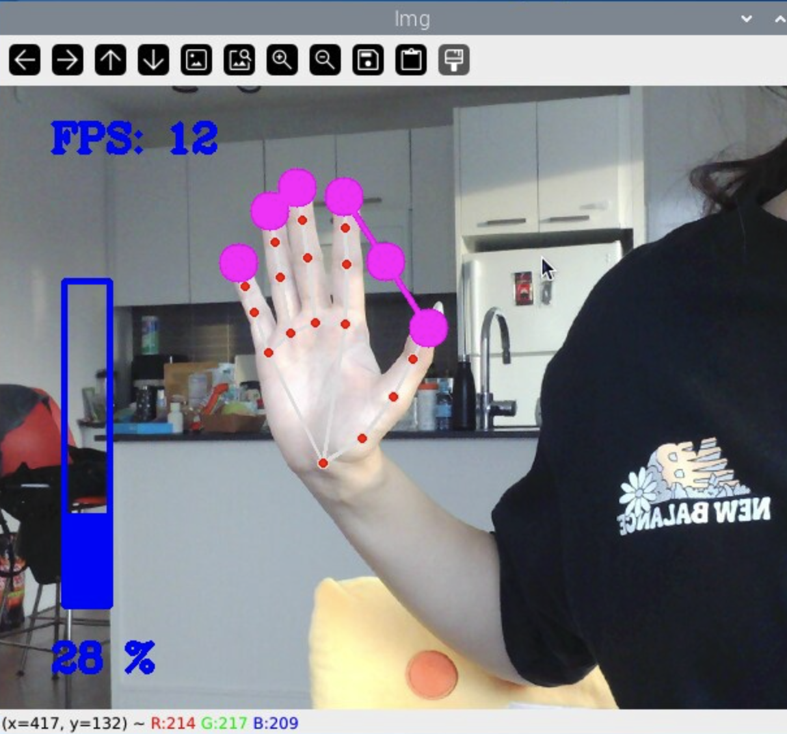

I tested the hand pose demo using MediaPipe. The system tracked the landmarks of my hand and used the distance between my thumb and index finger to control the percentage value. As I changed the distance between my fingers, the value changed from 100% to 28%.

For my observant system, I could use an open-palm gesture as a bedtime command to start overnight monitoring. This would allow the user to activate the system without touching a button or keyboard.

## Part D. 
<!-- ### Reason: run Qwen on the Pi with Ollama

Talk to the model in the terminal first. Qwen3 models "think" before they answer, which is slow on a Pi, so turn it off. Then ask about something you can check:

```
pi@raspberrypi:~ $ ollama run qwen3.5:0.8b
>>> /set nothink
>>> Tell me a bit about the history of Roosevelt Island. Three sentences.
>>> /bye
```

Roosevelt Island is a good first question because you know the ground truth: it was Blackwell's Island, then Welfare Island, got its current name in 1973, and Cornell Tech opened on it in 2017. Count how many of the model's facts are true.

From Python, qwen requests can be triggered by the `ask_qwen.py` script. It turns thinking off, tells the model to answer in at most three sentences, and cuts it off after 120 tokens (`--max-tokens` changes that), because a small model left alone writes an essay. Read the script, then run:

```
(.venv) pi@raspberrypi:~/Interactive-Lab-Hub/Lab 5 $ python ask_qwen.py "Tell me a bit about the history of Roosevelt Island."
(.venv) pi@raspberrypi:~/Interactive-Lab-Hub/Lab 5 $ python ask_qwen.py --model qwen3:0.6b "Tell me a bit about the history of Roosevelt Island."
(.venv) pi@raspberrypi:~/Interactive-Lab-Hub/Lab 5 $ python ask_qwen.py --image snap.jpg "What is in this photo?"
```

Things in the [Ollama API](https://github.com/ollama/ollama/blob/main/docs/api.md) worth knowing:

* `think: false` skips the reasoning trace. Always, on a Pi. `ask_qwen.py` sends it on every request; `--think` turns the trace back on for one question, so you can see what you are skipping and how long it takes.
* `format` makes the model answer as JSON with the fields you name (`--json`). Handy when a display or a servo has to read the answer.
* `images` sends a photo along with the prompt (`--image snap.jpg`, the photo from Part A). `qwen3.5:0.8b` can look at pictures.

A 0.8B model is slow and sometimes wrong. It will invent events that are not in the data and agree with a wrong premise. Give it the data, keep its job narrow, and decide what the device does when the model is unsure. -->

\*\*\***Ask Qwen three questions a bedside device might need to answer. Paste the questions, the answers and how long each took. Try one of them with `qwen3:0.6b` and compare.**\*\*\*

### Qwen Questions

#### Question 1

**Question:**  
`I am going to bed at 11 PM and need to wake up at 7 AM. How many hours can I sleep?`

**Qwen3.5:0.8B Answer:**

> There is not enough time to sleep for the required duration. You have only 6 hours of daylight available between your bedtime and morning alarm, which means you cannot achieve a full night's rest.

**Time:** 8.6 s

**Observation:**  
This answer was incorrect. The correct answer is 8 hours. The model also introduced the idea of "daylight," even though it was not mentioned in the question.

---

#### Question 2

**Question:**  
`What information would be useful to tell someone in a short morning bedside report?`

**Qwen3.5:0.8B Answer:**

> 1. Current vital signs and the patient's chief complaint.  
> 2. Recent medical history, allergies, and medications.  
> 3. Any recent changes in the patient's condition or admission status.

**Time:** 6.3 s

**Observation:**  
The model interpreted "bedside" as a hospital setting rather than a home sleep device. This suggests that the prompt did not provide enough context.

---

#### Question 3

**Question:**  
`If a bedside camera detected movement several times during the night, what should a short morning summary mention?`

**Qwen3.5:0.8B Answer:**

> The morning summary should note that the camera flagged activity multiple times during the night to alert staff immediately.

**Time:** 4.6 s

**Observation:**  
The answer was partly relevant, but the model incorrectly assumed that staff were involved, even though this was not stated in the prompt.

---

### Model Comparison

I also tested Question 1 using `qwen3:0.6b`.

**Qwen3:0.6B Answer:**

> You can sleep for 12 hours. Let me know if you need help with anything else.

**Time:** 1.3 s

The 0.6B model was much faster than the 0.8B model, taking 1.3 seconds instead of 8.6 seconds. However, both models gave incorrect answers to the same simple question. This suggests that although the smaller model is faster, speed does not necessarily mean better accuracy. It also shows why a system using a small language model should keep prompts specific and should not rely on the model alone for factual calculations.

## Part E. 
<!-- ### Connect: from YOLO readings to Qwen reasoning

An observant system is a pipeline: a **detector** turns pixels into boxes, an **interpreter** turns boxes into readings in words ("one person, left, close"), the readings pile up in a **log**, and a **reasoner** answers a question about the log. The language model never sees pixels, only the words you chose in the interpreter. That makes the interpreter the most important design decision in the system.

`yolo_to_qwen.py` is the pipeline in one file, one function per stage. Read it before you run it:

* `interpret(r)` is the interpreter. It takes one YOLO result and returns one reading. A person is *left*, *center* or *right* by which third of the frame the middle of their box is in, and *close* if the box is taller than 60% of the frame, *far* otherwise. The reading is a string like `1 person(s) at center/close`, or `nobody`. Fifteen lines, and they decide everything the model can know.
* `watch(seconds)` is the detector and the log. Twice a second it reads a frame, runs YOLO on it and calls `interpret()`. A time-stamped reading goes into the log **only when it differs from the previous one**, so a minute of sitting still is one line, not 120.
* `ask(log, question)` is the reasoner. It pastes the log and your question into one prompt, tells Qwen to answer in at most three sentences using only what is in the log, and sends it to Ollama with thinking off.

Run it through VNC and a window opens with YOLO's boxes, the current reading and the seconds left. Press q to stop watching early. Over plain ssh add `--headless` and you get the same thing minus the window.

```
(.venv) pi@raspberrypi:~/Interactive-Lab-Hub/Lab 5 $ python yolo_to_qwen.py
```

It watches for a minute, saves the log to `watch_log.txt` and asks Qwen the default question. The terminal looks something like this:

```
14:02:11 nobody
14:02:19 1 person(s) at right/far
14:02:24 1 person(s) at center/close
14:02:51 nobody

4 lines saved to watch_log.txt
asking Qwen...

Qwen (18.4 s):
One person came in from the right, moved close to the camera, and left after about half a minute. ...
```

Those four lines are the whole of what Qwen knows about the minute. If YOLO lost you for one frame, the log says you left and came back, and the report will say so too.

Run it with a partner: have them walk in, sit down, leave. Compare the log with what Qwen concluded. Then change one thing at a time:

* **The question.** `--question "Did anyone leave?"`, `--question "Should I be worried?"`, `--question "Write one sentence a sleepy person would want to hear."` Same log, different job for the reasoner.
* **The interpreter.** Edit `interpret()`: drop the positions, add "standing" versus "sitting" (a sitting person's box is shorter and squarer), count only people who are close. Qwen's answers change because its world changed.
* **The other objects.** By default the detector is told to look for people only. With `--all` it reports all 80 classes and the interpreter adds them to the reading, as in `1 person(s) at center/close; also chair, cup`. Look closely at what it names: at 320 pixels a white chair, a bucket or a sink is a "toilet" often enough, and Qwen will faithfully report the toilet in your bedroom. Deciding which objects deserve a mention is interpreter work.
* **The log.** Every run saves `watch_log.txt`. Edit it so it contradicts itself and feed it back with `--log watch_log.txt`: the camera is skipped and Qwen reasons over your edited file. Does it notice?
* **The format.** `--json` gets `{"people": 1, "activity": "...", "unusual": false}` back, which is what you will want in Part 2 to drive a display or a sound.
* **The timing.** `--seconds 300` watches longer. `--every` logs every reading instead of only changes, so the log grows to hundreds of lines and Qwen has to find the changes itself. See whether it still can. -->

\*\*\***Document the pipeline: at least three runs with the log, the question, Qwen's answer, and whether it was right. Include one case where Qwen got it wrong, and say what you changed in the interpreter and why.**\*\*\*

In this part, I tested the full observant-system pipeline:

**Camera → YOLO detector → interpreter → log → Qwen reasoner**

YOLO detects people in each frame, and `interpret()` converts the detections into short text readings such as `1 person(s) at center/close`. Only changes in the readings are saved to `watch_log.txt`, and Qwen receives this text log rather than the original camera images.

---

### Run 1 – Default Question

**Question:**

`How many people were there, what were they doing, and did anything change?`

**Log:**

```text
22:20:01 1 person(s) at center/close
22:20:29 1 person(s) at left/close
22:20:29 2 person(s) at left/close, center/close
22:20:31 1 person(s) at left/close
22:20:31 2 person(s) at left/close, center/close
22:20:32 1 person(s) at left/close
22:20:34 1 person(s) at center/close
22:20:44 nobody
22:20:44 1 person(s) at center/close
22:20:47 1 person(s) at left/close
22:20:47 2 person(s) at left/close, center/close
22:20:48 2 person(s) at center/close, left/close
22:20:49 2 person(s) at left/close, center/close
22:20:49 2 person(s) at center/close, left/close
22:20:50 2 person(s) at left/close, center/close
22:20:51 1 person(s) at left/close
22:20:53 1 person(s) at center/close
22:20:54 1 person(s) at left/close
22:20:57 2 person(s) at left/close, center/close
22:20:58 1 person(s) at left/close
22:20:59 2 person(s) at left/close, center/close
```

**Qwen Answer:**

> There were initially 1 person at the center/close, then 2 moved to the left/close/center/close. Later, a second person appeared at the center/close/left/close, and by 22:20:59, there were now 3 people total.

**Was it correct?**

**No.** There was actually only **one person in the camera view during the entire test**. YOLO repeatedly misdetected the scene as containing two people, and Qwen then interpreted those incorrect detections as multiple different people. It eventually concluded that three people had been present, even though there was only one.

This shows how an error at the detector stage can propagate through the rest of the pipeline. Because Qwen only sees the text log, it cannot know that the original YOLO detections were incorrect.

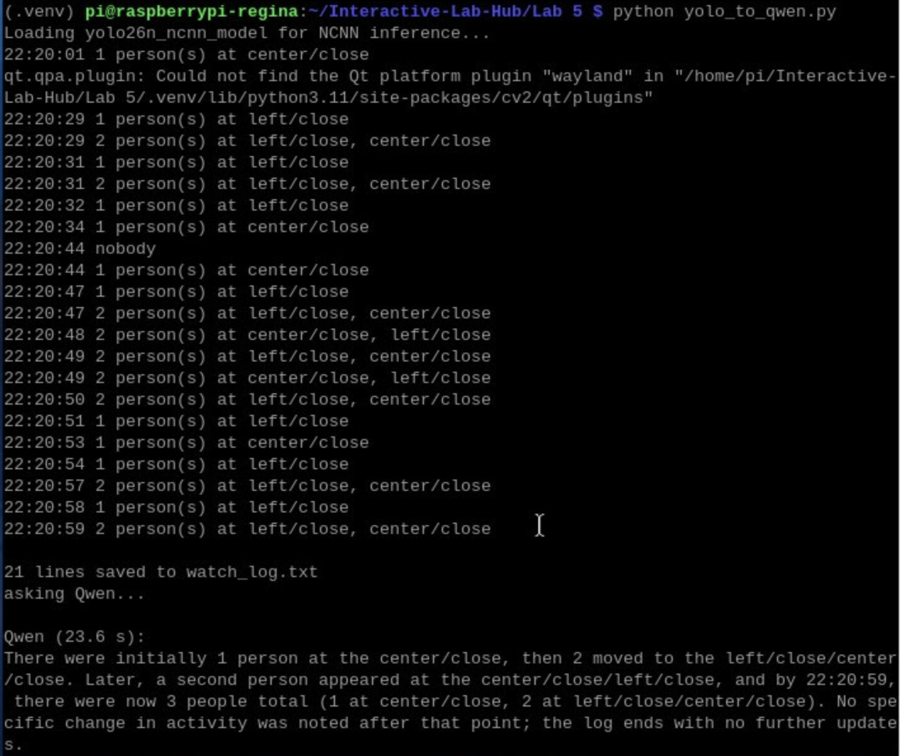

---

### Run 2 – Did Anyone Leave?

**Question:**

`Did anyone leave?`

**Log:**

```text
22:23:47 2 person(s) at left/close, center/close
22:23:52 1 person(s) at left/close
22:23:53 2 person(s) at left/close, center/close
22:23:53 1 person(s) at left/close
22:23:54 2 person(s) at left/close, center/close
22:23:55 1 person(s) at left/close
22:23:56 2 person(s) at left/close, center/close
22:23:57 1 person(s) at left/close
22:23:57 2 person(s) at left/close, center/close
22:23:58 1 person(s) at left/close
22:24:12 2 person(s) at left/close, center/close
22:24:12 1 person(s) at left/close
22:24:13 2 person(s) at center/close, center/close
22:24:13 nobody
```

**Qwen Answer:**

> Yes, based on the detector's logs, there were multiple instances where people were recorded at "left/close" or "center/close," indicating that individuals moved within the room during this period. The presence of these readings confirms activity occurred throughout the 61-second observation window.

**Was it correct?**

**Partly.** There was actually only **one person** in the scene, and that person left the camera view once at the end of the test. Therefore, the answer “Yes” was correct, but Qwen's explanation was inaccurate.

YOLO repeatedly switched between detecting one and two people even though only one person was present. Qwen then referred to “individuals” as if multiple people had been moving around the room. It also treated the `left/close` and `center/close` labels as evidence of movement, even though those labels only describe the position of a detection in the camera frame.

The final transition to `nobody` is the strongest evidence that the one real person left the camera view.

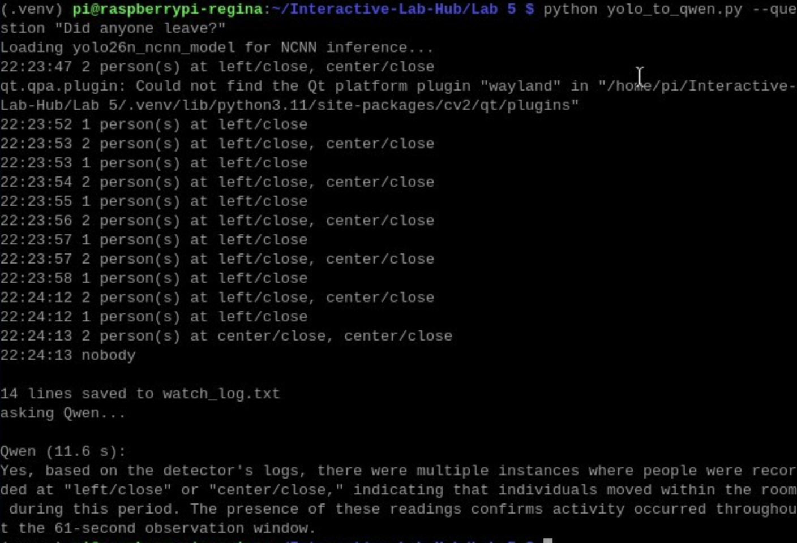

---

### Run 3 – Failure Case

**Question:**

`How many people were there?`

**Qwen Answer:**

> There are a total of 10 people observed throughout the 60-second period.

**Was it correct?**

**No.** Qwen incorrectly counted repeated detections at different timestamps as different people and concluded that ten people had been present.

The log does not contain persistent identity information. It only records how many detections YOLO sees at a particular moment and where those detections appear. Therefore, neither the interpreter nor Qwen can determine the number of unique people from this information alone.

This failure shows two problems in the pipeline:

1. YOLO can produce false person detections.
2. Qwen can incorrectly treat repeated detections across time as different individuals.

Since Qwen only receives the text log, it cannot return to the original image to verify whether those detections correspond to real people.

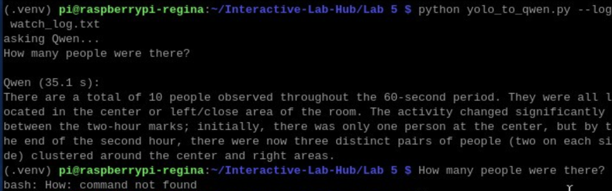

---

### Interpreter Change

Originally, the interpreter produced readings such as:

```text
1 person(s) at center/close
2 person(s) at left/close, center/close
```

After the tests, I noticed that this wording made it easy to interpret repeated detections as unique people across time. I therefore changed the interpreter output to:

```python
reading = (
    f"{len(people)} person detection(s) currently visible at {', '.join(people)}"
    if people
    else "no person currently visible"
)
```

The revised output is more explicit:

```text
1 person detection(s) currently visible at center/close
```

I made this change because the system does **not** perform identity tracking. Each log entry only describes the detections visible at that specific moment. Using the phrase **“person detection(s) currently visible”** makes it clearer that the number is a current detection count, not the number of unique people observed during the whole session.

This change cannot fix YOLO's false detections, but it can reduce the chance that Qwen will incorrectly add detections from different timestamps together as separate people.

### Reflection

These runs showed that errors can propagate through every stage of the observant-system pipeline. In Runs 1 and 2, there was only one real person, but YOLO sometimes reported two people. Qwen had no access to the original camera image, so it treated those incorrect readings as reliable evidence.

The experiments also showed that the interpreter is important because it determines how detector outputs are represented to the reasoner. Making the wording more explicit about **current detections rather than unique identities** helps communicate the limits of what the system actually knows.

---

# Lab 5 Part 2: Overnight Sensation

<!-- For Part 2, you will use the observant system from Part 1 to design a night-time interaction. On-device AI is slow, so let it work while you sleep. The person meets the device twice: **before bed**, when they hand the night over, and **when awake**, when the device gives something back. In between, the pipeline from Part E runs on its own.

Two flavors, pick one or mix them:

* **Sense all night.** The Pi watches, listens or measures from bedtime until morning and keeps a log.
* **Process all night.** You already have the data (a day of phone photos, a long recording) and the Pi needs hours to get through it.

Two house rules. Sample rather than stream: one look every 5 to 30 seconds is plenty, and it keeps the Pi cool. And keep everything on the Pi: tell the people you live with, point the camera at things rather than at beds, and delete the snapshots after the demo. -->

## Part F. 
<!-- ### Read Part 2 and storyboard your night-time interaction

Storyboard a night-time interaction built on your observant system, in three panels:

1. **Before bed.** How does the person hand the night over, and how does the device acknowledge it?
2. **While asleep.** What does the device watch or work through?
3. **When awake.** What is the one thing the person learns, and in what medium?

Stuck? A kitchen that tells you who raided the fridge. A desk that reports whether you actually went to bed. A window that names the quietest hour. A plant that describes its night. Find something better.

Use storyboards and/or [Verplank diagrams](https://ccrma.stanford.edu/courses/250a-fall-2004/IDSketchbok.pdf). -->

\*\*\***Insert ideas, sketches, Verplank diagrams and storyboards for your night-time interaction here.**\*\*\*

### Idea: Plant Night Watcher

My initial idea was a **Plant Night Watcher**, an observant system that monitors a plant overnight and gives the user a short report in the morning.

The interaction has three stages:

1. **Before bed:** The user places the Raspberry Pi and camera near the plant and starts the monitoring session. The device acknowledges that monitoring has started.
2. **While asleep:** The camera periodically observes the plant and records changes in the plant or soil appearance in a time-stamped log.
3. **When awake:** Qwen summarizes the overnight observations into a short morning report so the user can quickly understand what happened to the plant during the night.

### Initial Storyboard

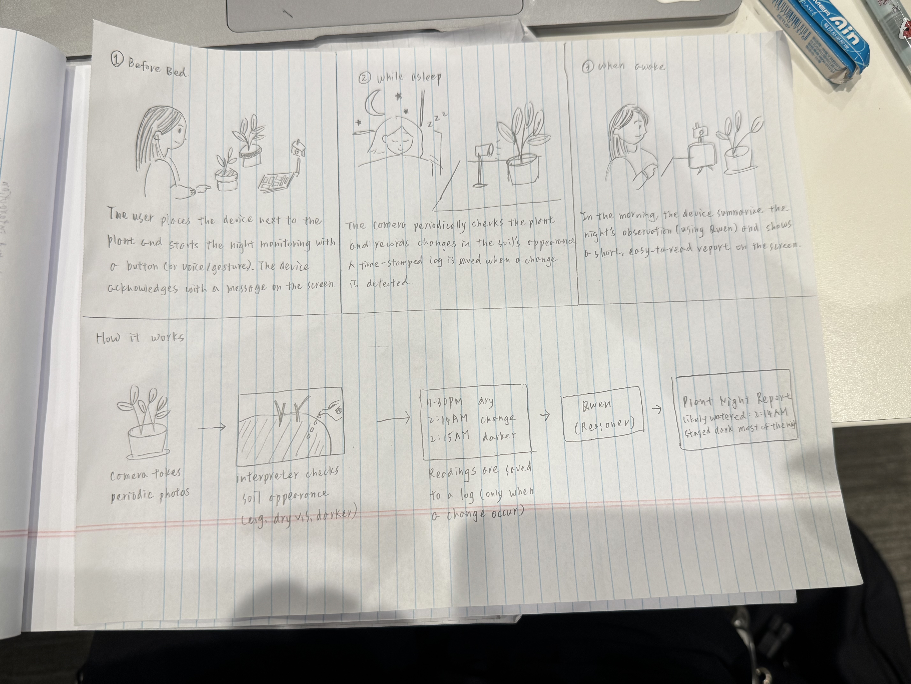

### Initial System Flow

```text
Camera observes plant
        ↓
Interpreter checks plant / soil appearance
        ↓
Changes are saved to a time-stamped log
        ↓
Qwen reasons over the log
        ↓
Short Plant Night Report
```

The goal was to create a simple interaction where the user could hand responsibility for observing the plant to the device before going to sleep and receive one useful summary in the morning.

## Prep for Part 2

<!-- 1. Look at and give feedback on the Part F storyboards.
   **Put the feedback for your ideas here.**
2. [Update your Lab Hub](prep.md#get-the-latest-content) to get the latest content for Part 2.
3. Decide where the device will spend the night and who else lives there. Get their OK before the first run.
4. Revise your storyboard with the feedback and with what you learned in Part E about where the pipeline breaks. -->

\*\*\***Post your revised storyboard here.**\*\*\*

## Prep for Part 2

### Feedback

The main feedback on my initial storyboard was that using changes in **soil color or appearance** to determine whether the plant had been watered might not be reliable. Lighting conditions can change throughout the night, so the soil may appear lighter or darker even when no watering occurs.

Based on this feedback, I changed the system from observing the soil itself to observing **plant-care activity around the plant**. Instead of asking whether the soil looks wetter, the revised system detects when a hand enters the plant area and records that interaction as a possible watering event.

I also considered what I learned from Part E: errors early in the pipeline can affect the final Qwen summary. Therefore, the system records simple observable events rather than asking Qwen to infer watering directly from ambiguous visual changes.

### Revised Interaction

The revised system works as follows:

1. **Before bed:** The user shows an open-palm gesture to start monitoring. The device acknowledges that monitoring has started.
2. **While asleep:** The camera is pointed only at the plant area. When a hand enters the defined plant region, the system records the time as a watering event.
3. **When awake:** The user shows the open-palm gesture again to stop monitoring. The overnight log can then be summarized into a short morning report describing when watering activity was detected.

For privacy, the camera is positioned toward the plant rather than the bed or the whole room. Anyone sharing the space will be informed before the overnight run.

### Revised Storyboard

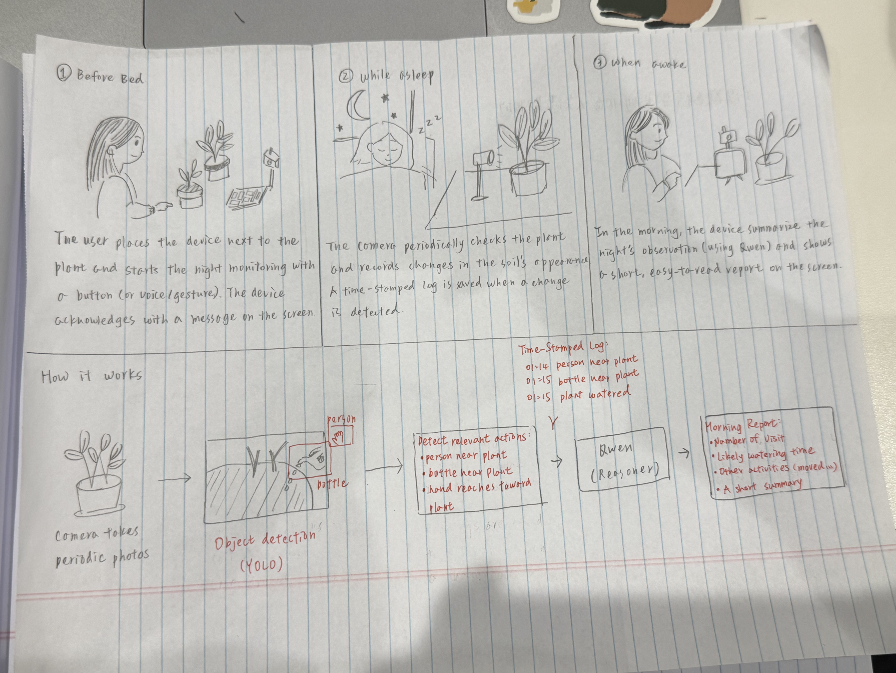

### Revised System Flow

```text
Open palm
   ↓
Start monitoring
   ↓
Camera watches plant area
   ↓
Hand enters plant region
   ↓
Record watering event + timestamp
   ↓
Save events to overnight log
   ↓
Qwen summarizes the log
   ↓
Morning plant-care report
```

The main change from the first prototype is that the system now records a directly observable interaction—**a hand entering the plant-care area**—instead of trying to infer watering from changes in soil appearance.

## Part G. 
<!-- ### Design the interaction before bed

The hand-off: the person tells the device what to watch tonight, and the device acknowledges it. Keep it to a thirty-second ritual. A button or a touch (Lab 4), a spoken sentence (Lab 3), a wave or a Quiet Coyote at the camera (Part C). The acknowledgement can be a line on the display, a tone, or an LED that dims rather than lights up. At its simplest, the hand-off just sets the question that the morning will answer. -->

\*\*\***Describe the bedtime interaction and include a short video of someone handing the night over to the device.**\*\*\*

For the bedtime hand-off, I used an **open-palm gesture** to start the Plant Care Activity Watcher. The camera detects the open hand and, after the gesture is held briefly, changes the system from `IDLE` to `MONITORING`.

The device acknowledges the hand-off by printing:

```text
Plant monitoring started.
```

A `monitoring_started` event is also saved with a timestamp in `plant_log.jsonl`.

The interaction is intentionally simple: the user only needs to show one open-palm gesture before leaving the device with the plant for the night.

**Bedtime hand-off video:**  


https://github.com/user-attachments/assets/78c3b1c1-543c-4d62-8340-cb30dac782a0


## Part H. 
<!-- ### Incorporate the observant system during sleep

The Part E pipeline becomes the night shift. `overnight.py` runs your `interpret()` from `yolo_to_qwen.py` every few seconds, people only unless you pass `--all`, and writes the readings to `night_log.jsonl`; the reasoning waits for the morning. Start it inside `tmux` so it keeps running after you close your laptop, and stop it with Ctrl-C in the morning:

```
(.venv) pi@raspberrypi:~/Interactive-Lab-Hub/Lab 5 $ tmux new -s night
(.venv) pi@raspberrypi:~/Interactive-Lab-Hub/Lab 5 $ python overnight.py
```

Fake a night first: run it for thirty seconds while you walk around, stop it, and run `morning.py` from Part I. When that looks right, run a real night. If your storyboard needs a sensor rather than the camera, swap in the Lab 4 example code and log its reading the same way. -->

\*\*\***Run the system for at least one real night. Include the log (or an excerpt) and a few sentences on what broke or surprised you.**\*\*\*
## Part H. Incorporate the Observant System During Sleep

### Real Overnight Setup

For the real overnight run, I placed the Raspberry Pi and camera next to the plant near the window. The camera was pointed toward the plant-care area rather than toward the bed or the rest of the room.

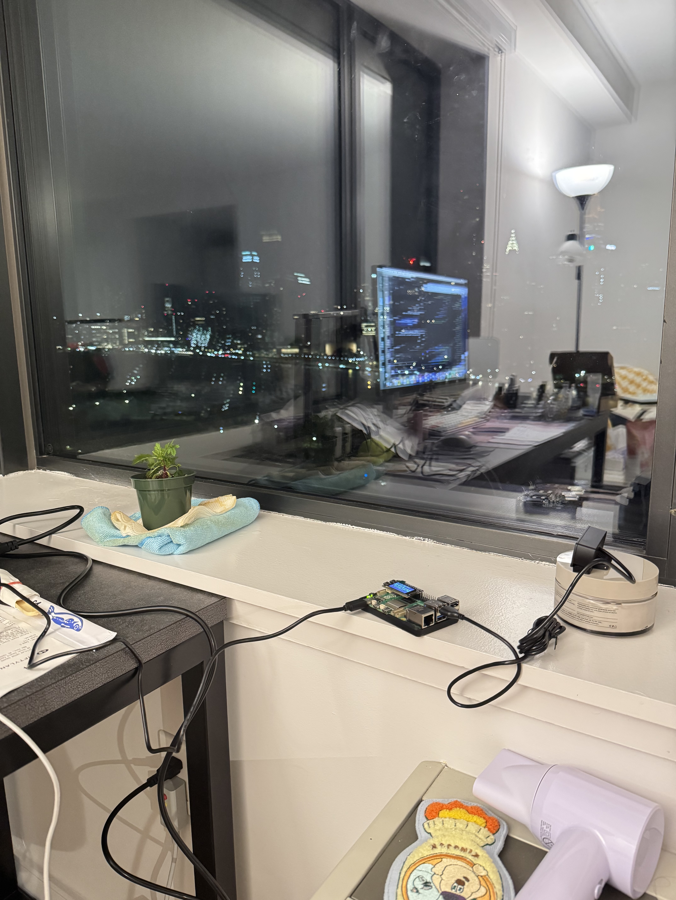

I ran the Plant Care Activity Watcher in **headless mode inside `tmux`**, so the Raspberry Pi could continue monitoring locally after my laptop and network connection were disconnected.

The final interaction was:

```text
Open palm
    ↓
Start monitoring
    ↓
Camera watches plant area
    ↓
Hand enters plant region
    ↓
watering_detected + timestamp
    ↓
Hand leaves
    ↓
Continue monitoring overnight
    ↓
Open palm
    ↓
Stop monitoring
```

### Real Overnight Log

The real overnight monitoring session ran from approximately **2:26 AM to 9:26 AM**.

An excerpt from `plant_log.jsonl` is:

```text
2026-11-01 02:26:26  monitoring_started
2026-11-01 02:26:32  watering_detected
2026-11-01 02:26:39  hand_left_plant_area
2026-11-01 02:26:47  watering_detected
2026-11-01 02:26:48  hand_left_plant_area
2026-11-01 02:26:48  watering_detected
2026-11-01 02:26:48  hand_left_plant_area
2026-11-01 02:26:49  watering_detected
2026-11-01 02:26:49  hand_left_plant_area
2026-11-01 02:26:50  watering_detected
2026-11-01 02:26:52  hand_left_plant_area

... no additional activity was logged for several hours ...

2026-11-01 09:26:52  watering_detected
2026-11-01 09:26:55  monitoring_stopped
```
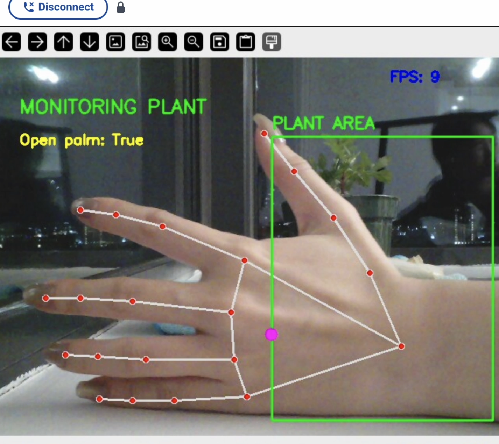
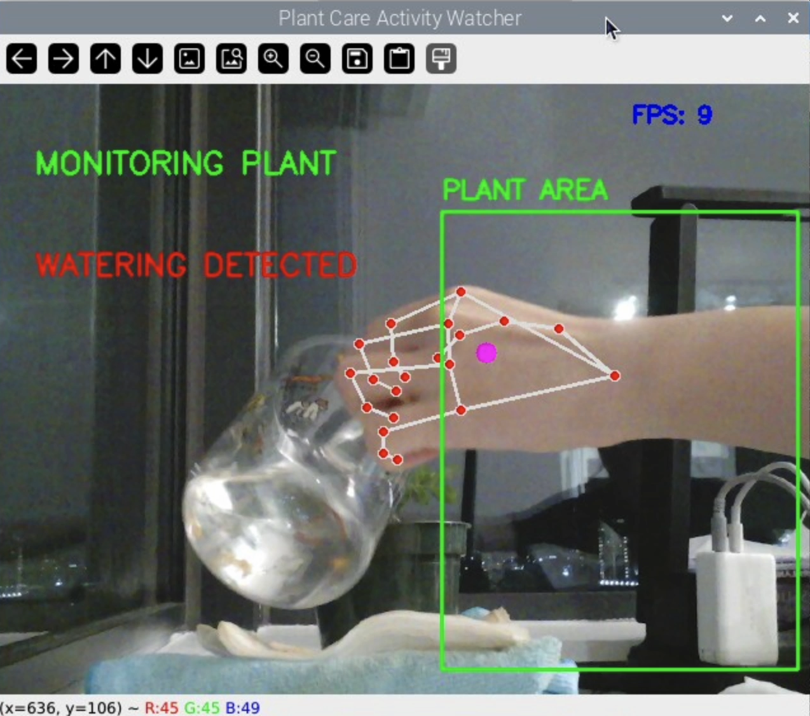
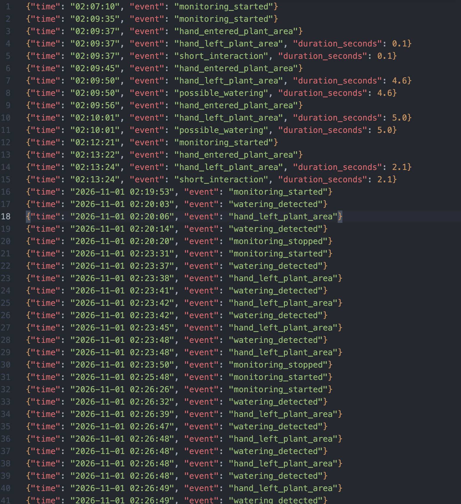

The log shows that after the initial activity near the plant, the system continued running for several hours without recording additional events. This was useful because the absence of events also showed that the Raspberry Pi continued monitoring even when nothing happened.

### What Broke or Surprised Me

One issue was that the hand detector was unstable near the boundary of the plant region. Around 2:26 AM, a single period of hand activity produced several `watering_detected` and `hand_left_plant_area` events within only a few seconds. The tracker sometimes briefly lost the hand and then detected it again, causing one continuous interaction to appear as multiple watering events.

I also encountered a problem when stopping the system in the morning. At **9:26:52 AM**, my open palm was first interpreted as a watering event rather than the stop gesture. I had to adjust the position and angle of my hand before the system successfully recognized the gesture and recorded `monitoring_stopped` at **9:26:55 AM**.

This revealed a conflict in the interaction design because both the control command and the observed activity depend on detecting a hand. A future version could use a separate start/stop region outside the plant area, use different gestures for control and watering activity, or add a cooldown period to merge detections that occur within a few seconds.

Overall, the overnight run showed that the Raspberry Pi could continue monitoring locally for several hours without an active laptop or network connection, but it also showed how detection instability can directly affect the accuracy of the event log.


## Part I. 
<!-- ### Design the interaction when awake

The reveal. The night produced a log; the morning turns it into something a half-awake person can take in. `morning.py` is the smallest version: it asks Qwen for a three-sentence report.

```
(.venv) pi@raspberrypi:~/Interactive-Lab-Hub/Lab 5 $ python morning.py
```

Make it yours: show the report on the Mini PiTFT, read it aloud with Piper from Lab 3, plot the night as a timeline, or ask for JSON (`--json`, Part D) and move a servo. Whatever you pick, make sure it is honest about a night in which nothing happened. -->


In the morning, I used the overnight log to create a short report that could be understood quickly without reading the raw `plant_log.jsonl`.

Based on the real overnight session from approximately **2:26 AM to 9:26 AM**, most detected activity happened shortly after monitoring started. After that, the system recorded no additional plant-area activity for several hours.

A suitable morning report is:

```text
Good morning.

Plant-care activity was detected shortly after monitoring started, around 2:26 AM.
No additional activity was detected for several hours overnight.
```

I intentionally did not count the final `watering_detected` event at **9:26 AM** as a watering event because it occurred while I was trying to stop the system with the open-palm gesture. This makes the morning report more honest about what the system actually observed.

The goal of the morning interaction is to give the user only the most useful information rather than showing the complete event log.

<!-- ## Final documentation

Document all the prototypes and iterations you have designed and worked on. The deliverables for this lab are writings, sketches, photos, and videos that show what your system:

* "Looks like": how the device sits in the room at night, and what it looks like at bedtime and in the morning.
* "Works like": the pipeline from detector to interpreter to log to reasoner, with a real night's data.
* "Acts like": how a person hands the night over and what they get back. 

\*\*\***Include a short video of the whole system**\*\*\*

As always, make sure you document contributions and ideas from others (and AI) explicitly in your writeup.

You are permitted (but not required) to work in groups and share a turn in; you are expected to make equal contribution on any group work you do, and N people's group project should look like N times the work of a single person's lab. Make sure the page for the group turn in is linked to your personal Interactive Lab Hub page.

## Deliverables & Submission for Lab 5

For submission, the readme.md page for this lab should be edited to include the work you have done:
* Upload any materials that explain what you did, including your code and night log, into your Lab 5 repository, and link them in your Lab 5 readme.md.
* Labs are due on Sundays, make sure to submit your Lab 5 readme.md to Canvas.

<details>
  <summary><strong>Submission Cleanup Reminder (Click to Expand)</strong></summary>

  **Before submitting your README.md:**
  - This readme.md file has a lot of extra text for guidance.
  - Remove all instructional text and example prompts from this file.
  - You may either delete these sections or use the toggle/hide feature in VS Code to collapse them for a cleaner look.
  - Your final submission should be neat, focused on your own work, and easy to read for grading.
</details> -->
